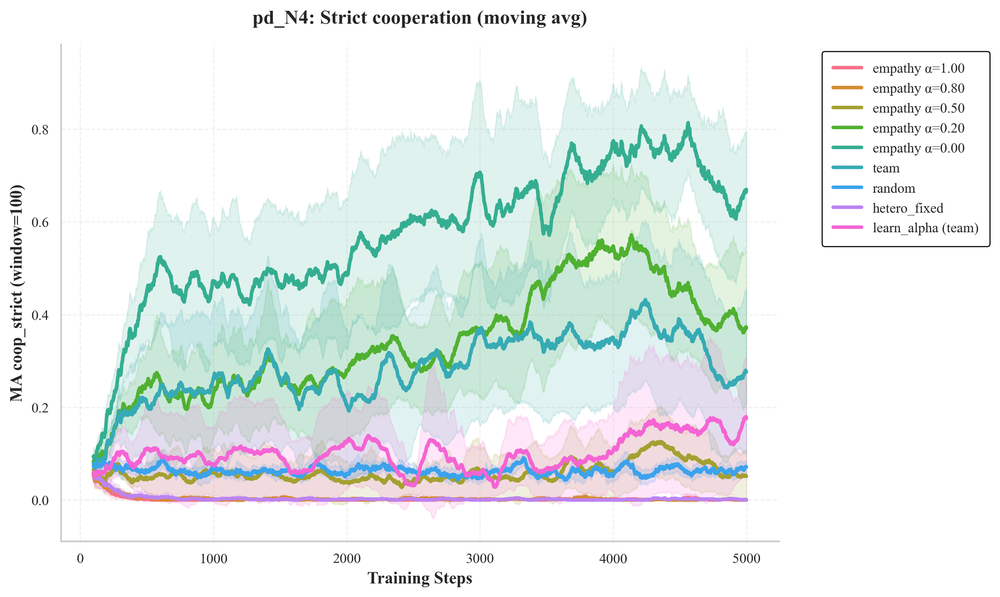
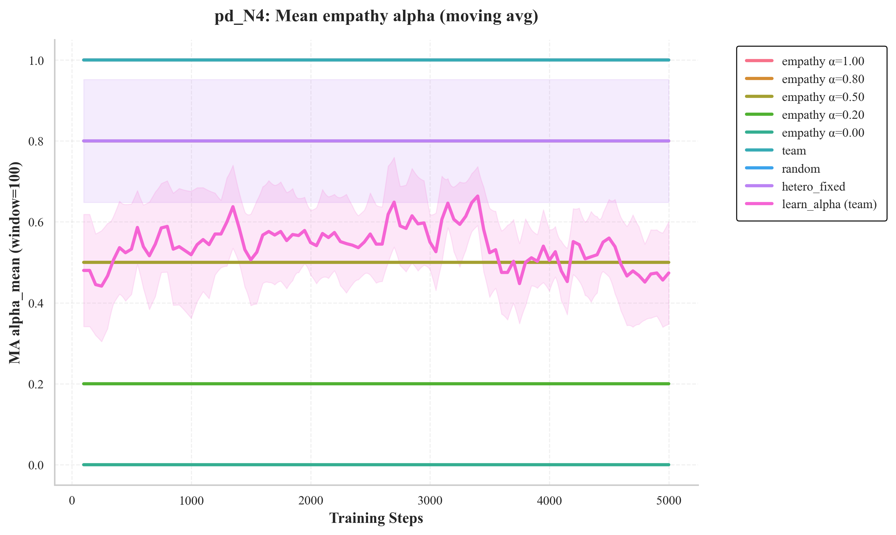
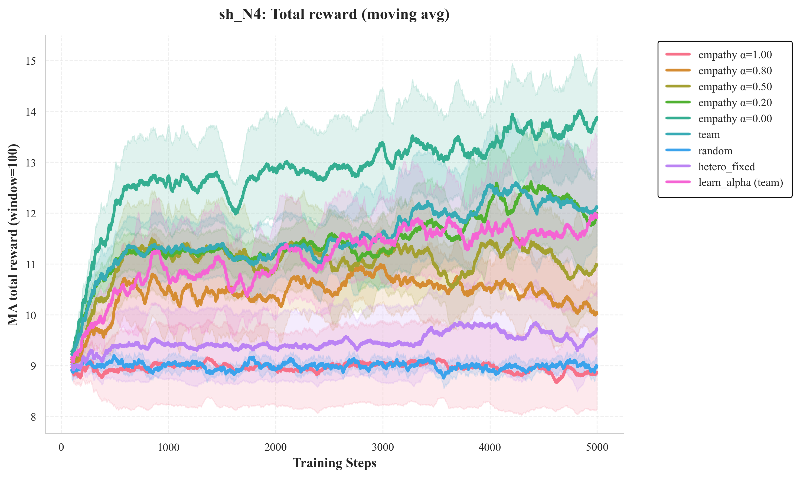
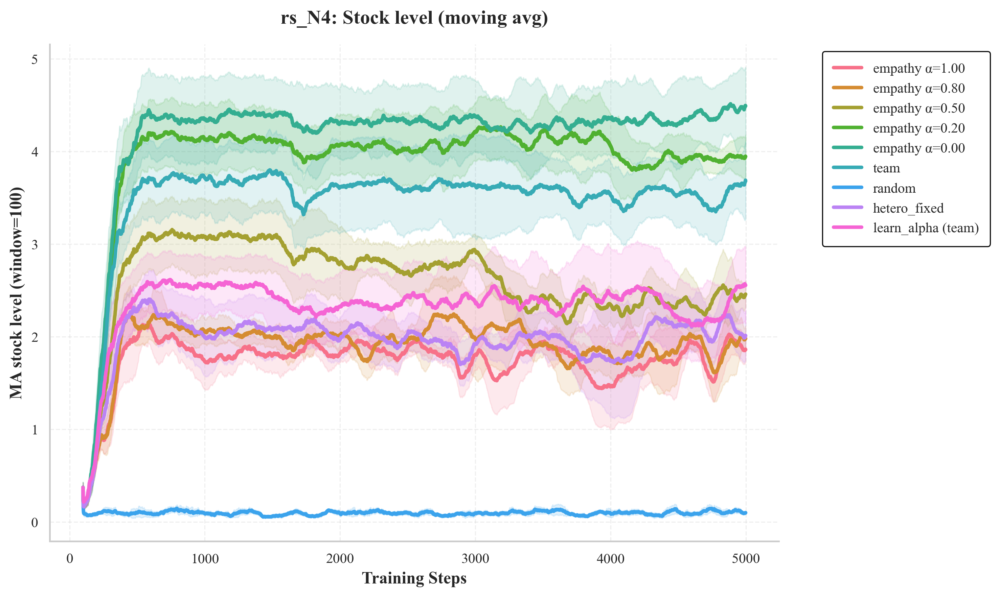

# Empathy in Multi-Agent Reinforcement Learning

**Fixed empathy vs. endogenous adaptation in social dilemmas**

Christina Eirini Christodoulou · Simone De Giorgi · Lavinia Maria Alexandra Skandali
Research project at [BSML – Bocconi Students for Machine Learning](https://github.com/bs-machinelearning), Università Bocconi, Milan · December 2025

📄 **[Read the full report (PDF)](report/Empathy_in_MARL.pdf)**

---

## Overview

In multi-agent reinforcement learning, agents that only maximise their own reward often end up in socially inefficient outcomes: mutual defection, failed coordination, overuse of shared resources.

We study **empathy-weighted reward shaping**, where each agent also values the rewards of others, and ask two questions:

1. Does empathy improve cooperation and collective welfare?
2. If agents are allowed to **learn** their own empathy level, do they discover the optimal one?

**Key findings**

- High empathy consistently improves cooperation and welfare in the Prisoner's Dilemma, the Stag Hunt and a renewable resource-sharing game.
- Agents that **learn** empathy do *not* converge to that optimum. They settle at intermediate, suboptimal empathy levels.
- The limitation comes from the learning dynamics, not from empathy itself.

## Method

**Empathy-weighted reward.** Agent *i* is trained on

$$\tilde r_i(t) = \alpha_i \, r_i(t) + (1-\alpha_i)\,\frac{1}{N-1}\sum_{j\neq i} r_j(t)$$

where α = 1 is purely selfish and α = 0 is maximally empathic. Agents *learn* from the shaped reward, but all metrics are reported on the original environment rewards.

**Learning.** Independent tabular Q-learning with ε-greedy exploration (lr 0.2, γ 0.95, ε 1.0 → 0.05, decay 0.995), 5,000 steps.

**Conditions compared**

| Condition | Description |
|---|---|
| `empathy α ∈ {1.0, 0.8, 0.5, 0.2, 0.0}` | All agents share a fixed empathy level |
| `learn_alpha` | Each agent learns its α with an ε-greedy bandit (ε = 0.1), choosing a level every 50 steps and scoring it by average team reward |
| `team` | Every agent learns from the team-average reward |
| `hetero_fixed` | Agents get fixed but different α values |
| `random` | Uniformly random actions (baseline) |

**Environments**

| Experiment | Game | Agents | Cooperation means |
|---|---|---|---|
| `pd_N2`, `pd_N4` | Prisoner's Dilemma (C/D), pairwise round-robin | 2, 4 | everyone plays C |
| `sh_N4` | Stag Hunt (S/H), pairwise round-robin | 4 | everyone plays S |
| `rs_N4` | Renewable resource sharing: stock of 10, regenerates 2 per step, extraction ∈ {0, 1, 2}, collapse if overused | 4 | total extraction ≤ 4 |

Every condition is run over **10 random seeds**. The plots show the mean with 95% confidence intervals.

## Results

Mean over 10 seeds and the last 500 training steps. *Coop* = fraction of steps with full cooperation, *Welfare* = total reward per step.

| Condition | PD N=2 coop / welfare | PD N=4 coop / welfare | SH N=4 coop / welfare | RS N=4 welfare / collapse rate |
|---|---|---|---|---|
| empathy α = 1.0 (selfish) | 0.05 / 2.59 | 0.00 / 5.47 | 0.08 / 8.85 | 0.95 / 0.09 |
| empathy α = 0.5 | 0.92 / 5.91 | 0.07 / 9.41 | 0.21 / 10.93 | 1.47 / 0.04 |
| empathy α = 0.0 (max empathy) | **0.94 / 5.94** | **0.69 / 11.52** | **0.64 / 13.73** | **1.97 / 0.00** |
| learn_alpha | 0.88 / 5.87 | 0.16 / 9.34 | 0.38 / 11.67 | 1.35 / 0.05 |
| learned α (mean) | 0.27 | 0.47 | 0.42 | 0.51 |
| random | 0.26 / 4.53 | 0.06 / 8.99 | 0.06 / 9.01 | −1.95 / 0.92 |

With more agents, cooperation gets harder: in the 4-agent Prisoner's Dilemma only near-maximal empathy keeps agents cooperating. In the 4-agent games, learned empathy stalls around α ≈ 0.4–0.5, well short of the optimum.

<p align="center">
  
  
</p>
<p align="center">
  
  
</p>

All figures (cooperation, welfare, inequality, learned α, stock level, collapse frequency) for every experiment are in [`results/`](results/), and time-to-cooperation statistics are in [`results/summary_conditions.csv`](results/summary_conditions.csv).

## Repository structure

```
src/
  agent.py         Q-learning agent with fixed or bandit-learned empathy
  environment.py   N-agent matrix games (PD, SH) and resource-sharing environment
  config.py        Hyperparameters, payoffs, experiment definitions
  train.py         Runs all experiments × conditions × seeds, writes logs and plots
results/           Final plots (mean ± 95% CI) and summary CSV
report/            Full write-up
```

## Reproducing

```bash
python3 -m venv .venv && source .venv/bin/activate
pip install -r requirements.txt
python src/train.py
```

This runs all 4 experiments × 9 conditions × 10 seeds and writes per-step logs and plots to `logs_all/`. Settings are in [`src/config.py`](src/config.py).

## Credits

Joint work by **Christina Eirini Christodoulou, Simone De Giorgi and Lavinia Maria Alexandra Skandali** as part of BSML (Bocconi Students for Machine Learning).
This is a cleaned-up copy of the original project repository, [Simo-dg/empathetic-agents](https://github.com/Simo-dg/empathetic-agents), which also contains the full per-seed training logs.
